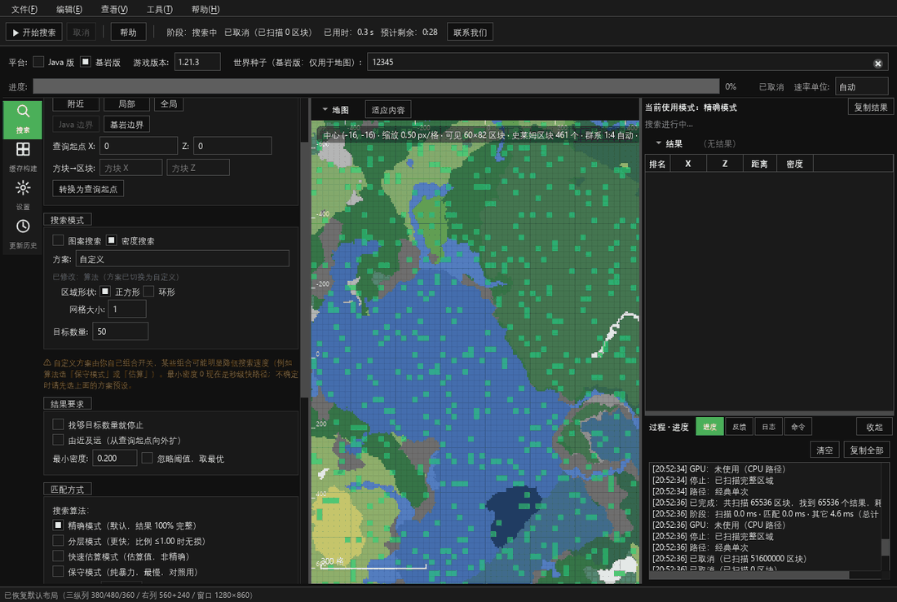

# SlimeFinder — Minecraft Slime Chunk Finder

[](https://github.com/PillerBean/SlimeFinder/releases)
[](https://github.com/PillerBean/SlimeFinder/releases)
[](LICENSE)
[](https://github.com/PillerBean/SlimeFinder/releases)

> 🌐 **Language:** [简体中文](README.md) · [繁體中文](README.zh-TW.md) · **English**
>
> 🤖 This page is an **AI translation** of the Simplified Chinese README. Feedback on translation
> quality is welcome via [Issues](https://github.com/PillerBean/SlimeFinder/issues).

A slime chunk finder for Minecraft **Java / Bedrock Edition**, built natively with **C++20 + Qt 6**,
with optional GPU acceleration and support for very large search ranges.
Results match the verified reference implementation bit-for-bit.

[Download](#downloads) · **[📦 Version index (sorted by version number)](https://github.com/PillerBean/SlimeFinder/wiki/Version-Index)** · [Wiki](https://github.com/PillerBean/SlimeFinder/wiki) · [Features](#features) · [FAQ](#faq) · [Issue tracker](https://github.com/PillerBean/SlimeFinder/issues)



## Downloads

| Channel | Notes |
|---|---|
| **Stable (Latest)** | <https://github.com/PillerBean/SlimeFinder/releases/latest> |
| **Test / historical versions** | <https://github.com/PillerBean/SlimeFinder/releases> (`Pre-release` marks a test build; historical versions are binary archives) |

- Platform: Windows 10/11 x64;
- **Installer only**: `SlimeFinder-*-Setup.exe` (installs to Program Files by default; administrator permission required);
- Updates: since v3.12.3 the app only notifies about new versions — no automatic download or installation.
  Download the Setup from Releases manually, verify SHA256, then install;
- Portable zip builds are discontinued; old zips remain available in historical Releases;
- Always use the Releases page as the source of truth; current stable: **v3.13.8**.
  **v3.12.3's stable status was withdrawn** (concurrent build-cache/save defect) — users who installed 3.12.3
  should upgrade and rebuild their cache.

> 📦 **Find any historical version by version number:** **[Open the version index (sorted by version)](https://github.com/PillerBean/SlimeFinder/wiki/Version-Index)**
> The GitHub Releases page is sorted by publish time (back-filled releases break the order); the version index is sorted from newest to oldest by version number.

## Features

- **Java / Bedrock** slime chunk detection, matching the reference implementation 117/117 case-by-case
- **Density mode**: threshold matching, best N results, early stop, smart range, layered/sampling algorithms
- **Pattern mode**: custom patterns (2×2, border, single cell, …) with rotation matching
- **Ring mode**: AFK ring coverage planning
- **GPU acceleration** (OpenCL): automatic detection, automatic CPU fallback on failure; optional pattern GPU streaming on AMD
- **Large-range search**: whole Java map / Bedrock precision bounds (±131,072 chunks) with bounded per-tile memory
- **Update check**: GitHub Releases official channel; **automatic mirror speed test** when the official channel is unreachable; manual Lanzou cloud fallback
- Historical cache, command terminal, logs, dark mode, built-in tutorial

## Quick start

1. Get `SlimeFinder-*-Setup.exe` from Releases and follow the installer (administrator permission required);
2. Launch `SlimeFinder.exe` from the Start menu or desktop;
3. Choose Java/Bedrock, the world seed, search range, and density/pattern mode, then click **Start search**;
4. GPU acceleration is optional (Settings → Performance); enable it for newer GPUs.

## System requirements

- Windows 10/11 x64;
- No separate Qt/runtime installation needed (the release package bundles required runtimes);
- GPU acceleration requires a working OpenCL driver (AMD / NVIDIA / Intel; falls back to CPU automatically on failure).

## Privacy & anonymous telemetry

The program runs offline by default and **anonymous telemetry is off by default**. You can opt in via
Help → Anonymous telemetry (help improve). When enabled it sends version, platform/hardware, game edition,
world seed, search settings, result summary/coordinates, and timing/speed data to improve the program.
It never sends save paths, log contents, accounts, or persistent IDs; the server does not store IP addresses.
See [docs/privacy.md](docs/privacy.md) for details.

## FAQ

- **Antivirus false positive**: the binary is not code-signed; some antivirus products may flag it.
  Download only from this repository's Releases and verify `SHA256SUMS`; add an exclusion if needed.
- **GPU does not help**: update your GPU driver; for small ranges or few hits the fixed GPU overhead dominates
  and CPU may be faster.
- **Update check fails**: automatic mode tries speed-tested mirrors; if it still fails, use
  "Open the cloud download page (fallback)".
- **Old versions**: Releases keeps historical binary archives; source code for old versions is not kept.

More in the [Wiki / FAQ](https://github.com/PillerBean/SlimeFinder/wiki) or [Issues](https://github.com/PillerBean/SlimeFinder/issues).

## Building from source

```bat
:: Requires VS2022, CMake 3.20+, Qt 6.11 msvc2022_64
cmd /c scripts\build\build_repo.cmd
build\slime_tests.exe --unit
```

For details (packaging, installer, self-test), see [docs/build_instructions.md](docs/build_instructions.md).

## Versioning & release rules

- Version numbers have four segments, e.g. `3.10.12.10`;
- **Stable release**: don't tick `Pre-release` ⇒ becomes Latest (manual download entry; no auto-update);
- **Test release**: tick `Pre-release` ⇒ never becomes Latest;
- Latest is controlled manually by the maintainer; full process in [docs/GITHUB_PUBLISH_GUIDE.md](docs/GITHUB_PUBLISH_GUIDE.md).

## License & credits

This project is **source-available for non-commercial use**:

- License: [PolyForm Noncommercial 1.0.0](LICENSE) (with Required Notice attribution requirements)
- Any copy, redistribution, or modified version must keep the copyright notice and Required Notice, and
  attribute the source: **SlimeFinder — <https://github.com/PillerBean/SlimeFinder>**
- Commercial use (including paid products/services or commercial operation) requires separate written
  permission from the author
- Third-party components: cubiomes (MIT), OpenCL-Headers (Apache-2.0), Qt 6 (LGPLv3/GPLv3/commercial;
  whichever Qt components are bundled in the release package); see [NOTICE](NOTICE)

## Documentation & Wiki

- [Wiki (quick start / features / GPU / updates / FAQ)](https://github.com/PillerBean/SlimeFinder/wiki)
- [Version index (sorted by version)](https://github.com/PillerBean/SlimeFinder/wiki/Version-Index)
- [User manual](docs/user_manual.md)
- [Build & packaging](docs/build_instructions.md)
- [GitHub publishing guide](docs/GITHUB_PUBLISH_GUIDE.md)
- [Community performance reference](docs/community_benchmark_reference.md)

## Author & feedback

- Author: PillerBean
- Bilibili: <https://space.bilibili.com/1413251461>
- Issues / feature requests: <https://github.com/PillerBean/SlimeFinder/issues>
