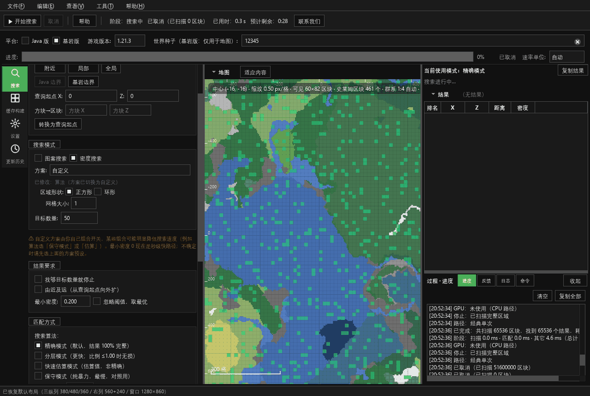

# SlimeFinder 史莱姆区块查找器

[](https://github.com/PillerBean/SlimeFinder/releases)
[](https://github.com/PillerBean/SlimeFinder/releases)
[](LICENSE)
[](https://github.com/PillerBean/SlimeFinder/releases)

Minecraft **Java / 基岩版史莱姆区块查找工具**：原生 **C++20 + Qt 6**，支持 GPU 加速与超大范围搜索。
判定结果与已验证的参考实现逐位一致。

> 英文简介：A slime chunk finder for Minecraft Java/Bedrock, native C++20/Qt6 with optional GPU acceleration.

[下载](#下载) · **[📦 版本索引（按版本号排序）](https://github.com/PillerBean/SlimeFinder/wiki/Version-Index)** · [Wiki](https://github.com/PillerBean/SlimeFinder/wiki) · [功能](#功能) · [常见问题](#常见问题) · [更新历史（GitHub）](https://github.com/PillerBean/SlimeFinder/wiki/Version-Index) · [问题反馈](https://github.com/PillerBean/SlimeFinder/issues)



## 下载

| 渠道 | 说明 |
|---|---|
| **正式版（Latest）** | <https://github.com/PillerBean/SlimeFinder/releases/latest> |
| **测试版 / 历史版本** | <https://github.com/PillerBean/SlimeFinder/releases>（带 `Pre-release` 标记的是测试版；历史版本为二进制归档） |

- 平台：Windows 10/11 x64；
- **只提供安装包** `SlimeFinder-*-Setup.exe`（默认安装到 Program Files，需管理员权限）；
- 更新方式：自 v3.12.3 起仅提示新版本，不再自动下载或自动安装；请手动前往 Releases 下载 Setup，核对 SHA256 后安装；
- 便携 zip 已停发；旧版本 zip 仍可从历史 Release 获取；
- 具体版本以 Releases 页面为准；当前正式版：**v3.13.5（AMD GPU 低门槛 + 判定位图复用）**。

> 📦 **按版本查找全部历史版本**：**[打开版本索引（按版本号排序）](https://github.com/PillerBean/SlimeFinder/wiki/Version-Index)**
> GitHub Releases 页面按发布时间排序（补传历史后会乱序），版本索引按版本号从新到旧排列。

## 功能

- **Java / 基岩版**史莱姆区块判定，与参考实现 117/117 逐条一致
- **密度模式**：阈值匹配、最优 N 个、提前停止、智能范围、分层/采样
- **图案模式**：自定义图案（2×2、边框、单格等）与旋转匹配
- **环形模式**：AFK 环形覆盖规划
- **GPU 加速**（OpenCL）：自动探测、失败自动回退 CPU；AMD 默认启用图案 GPU 流式
- **大范围搜索**：Java 整图 / 基岩精度边界（±131,072 区块），分块有界内存
- **检查更新**：GitHub Releases 官方；官方不可达时**自动测速镜像**；蓝奏云网盘手动备用
- 历史缓存、命令、日志、深色模式、内置教程

## 快速开始

1. 从 Releases 获取 `SlimeFinder-*-Setup.exe`，按向导安装（需管理员权限）；
2. 从开始菜单/桌面运行 `SlimeFinder.exe`；
3. 选择 Java/基岩版、种子、搜索范围、密度或图案模式，点「开始搜索」；
4. GPU 加速是可选项（设置 → 性能），显卡较新时建议开启。

## 系统要求

- Windows 10/11 x64；
- 无需单独安装 Qt/运行库（发行包已包含所需运行时）；
- GPU 加速需要可用的 OpenCL 驱动（AMD / NVIDIA / Intel 均可，失败自动回退 CPU）。

## 隐私与匿名统计

程序默认离线运行，**匿名统计默认关闭**。可在「帮助 → 匿名统计（帮助改进）」自愿开启；开启后会发送版本、平台/硬件、游戏平台、世界种子、搜索设置、结果摘要/坐标、耗时与速度等信息，用于改进程序。不发送存档路径、日志内容、账号或持久 ID；服务端不保存 IP。完整说明见 [docs/privacy.md](docs/privacy.md)。

## 常见问题

- **杀毒软件报毒**：程序未做代码签名，部分杀软会误报；请从本仓库 Releases 下载并核对 `SHA256SUMS`，必要时加白名单。
- **GPU 不生效**：更新显卡驱动；小范围/命中很少时 GPU 固定开销占比高，反而可能不如 CPU。
- **检查更新失败**：自动模式会测速镜像；仍失败可点「打开网盘下载页（备用）」。
- **旧版本**：Releases 保留历史二进制归档；旧版本源码未保留。

更多见 [Wiki / 常见问题](https://github.com/PillerBean/SlimeFinder/wiki) 或 [Issues](https://github.com/PillerBean/SlimeFinder/issues)。

## 从源码构建

```bat
:: 需要 VS2022、CMake 3.20+、Qt 6.11 msvc2022_64
cmd /c scripts\build\build_repo.cmd
build\slime_tests.exe --unit
```

详细步骤（打包、安装包、自检）见 [docs/build_instructions.md](docs/build_instructions.md)。

## 版本与发布规则

- 版本号统一四段，例如 `3.10.12.10`；
- **正式发布**：Release 不勾 `Pre-release` ⇒ 成为 Latest（作为手动下载入口，不再自动更新）；
- **测试发布**：勾选 `Pre-release` ⇒ 不会成为 Latest；
- Latest 由发布者手动控制；完整流程见 [docs/GITHUB_PUBLISH_GUIDE.md](docs/GITHUB_PUBLISH_GUIDE.md)。

## 许可与来源

本项目**源码公开、非商业使用**：

- 许可证：[PolyForm Noncommercial 1.0.0](LICENSE)（含 Required Notice 署名要求）
- 任何复制、再分发或修改版必须保留版权声明与 Required Notice，并注明来源：
  **SlimeFinder — <https://github.com/PillerBean/SlimeFinder>**
- 商业使用（含付费产品或服务、商业运营）需作者另行书面授权
- 第三方组件：cubiomes（MIT）、OpenCL-Headers（Apache-2.0）、Qt 6（LGPLv3/GPLv3/商业许可，
  以发行包内 Qt 组件为准）；详见 [NOTICE](NOTICE)

## 文档与 Wiki

- [Wiki（快速开始 / 功能 / GPU / 更新 / FAQ）](https://github.com/PillerBean/SlimeFinder/wiki)
- [版本索引（按版本号排序）](https://github.com/PillerBean/SlimeFinder/wiki/Version-Index)
- [用户手册](docs/user_manual.md)
- [构建与打包](docs/build_instructions.md)
- [更新历史（GitHub）](https://github.com/PillerBean/SlimeFinder/wiki/Version-Index)
- [GitHub 发布指南](docs/GITHUB_PUBLISH_GUIDE.md)
- [社区性能对照](docs/community_benchmark_reference.md)

## 作者与反馈

- 作者：PillerBean
- B 站主页：<https://space.bilibili.com/1413251461>
- 问题反馈 / 功能建议：<https://github.com/PillerBean/SlimeFinder/issues>
