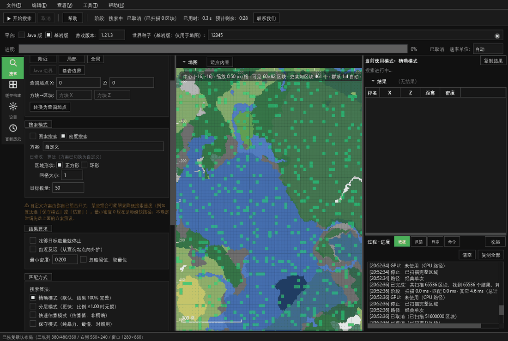

# SlimeFinder 史萊姆區塊查詢器

[](https://github.com/PillerBean/SlimeFinder/releases)
[](https://github.com/PillerBean/SlimeFinder/releases)
[](LICENSE)
[](https://github.com/PillerBean/SlimeFinder/releases)

> 🌐 **語言：** [简体中文](README.md) · **繁體中文** · [English](README.en.md)
>
> 🤖 本頁為簡體中文 README 的 **AI 翻譯**，翻譯品質問題歡迎透過
> [Issues](https://github.com/PillerBean/SlimeFinder/issues) 回饋。

Minecraft **Java / 基岩版史萊姆區塊查詢工具**：原生 **C++20 + Qt 6**，支援 GPU 加速與超大範圍搜尋。
判定結果與已驗證的參考實作逐位一致。

[下載](#下載) · **[📦 版本索引（依版本號排序）](https://github.com/PillerBean/SlimeFinder/wiki/Version-Index)** · [Wiki](https://github.com/PillerBean/SlimeFinder/wiki) · [功能](#功能) · [常見問題](#常見問題) · [問題回饋](https://github.com/PillerBean/SlimeFinder/issues)



## 下載

| 管道 | 說明 |
|---|---|
| **正式版（Latest）** | <https://github.com/PillerBean/SlimeFinder/releases/latest> |
| **測試版 / 歷史版本** | <https://github.com/PillerBean/SlimeFinder/releases>（帶 `Pre-release` 標記的是測試版；歷史版本為二進位封存） |

- 平台：Windows 10/11 x64；
- **僅提供安裝包** `SlimeFinder-*-Setup.exe`（預設安裝到 Program Files，需管理員權限）；
- 更新方式：自 v3.12.3 起僅提示新版本，不再自動下載或自動安裝；請手動前往 Releases 下載 Setup，核對 SHA256 後安裝；
- 免安裝 zip 已停止發佈；舊版 zip 仍可從歷史 Release 取得；
- 具體版本以 Releases 頁面為準；目前正式版：**v3.13.8**。**v3.12.3 已撤回正式版資格**
  （建置快取並行/儲存缺陷），已下載 3.12.3 的使用者請升級並重新建置快取。

> 📦 **依版本號查找全部歷史版本：** **[開啟版本索引（依版本號排序）](https://github.com/PillerBean/SlimeFinder/wiki/Version-Index)**
> GitHub Releases 頁面依發佈時間排序（補傳歷史後會亂序），版本索引依版本號從新到舊排列。

## 功能

- **Java / 基岩版**史萊姆區塊判定，與參考實作 117/117 逐條一致
- **密度模式**：閾值匹配、最佳 N 個、提前停止、智慧範圍、分層/取樣
- **圖案模式**：自訂圖案（2×2、邊框、單格等）與旋轉匹配
- **環形模式**：AFK 環形覆蓋規劃
- **GPU 加速**（OpenCL）：自動偵測、失敗自動回退 CPU；AMD 可選圖案 GPU 串流
- **大範圍搜尋**：Java 整圖 / 基岩精度邊界（±131,072 區塊），分塊有界記憶體
- **檢查更新**：GitHub Releases 官方；官方不可達時**自動測速鏡像**；藍奏雲網盤手動備用
- 歷史快取、命令、日誌、深色模式、內建教學

## 快速開始

1. 從 Releases 取得 `SlimeFinder-*-Setup.exe`，依精靈安裝（需管理員權限）；
2. 從開始功能表/桌面執行 `SlimeFinder.exe`；
3. 選擇 Java/基岩版、種子、搜尋範圍、密度或圖案模式，點「開始搜尋」；
4. GPU 加速為選項（設定 → 效能），顯示卡較新時建議開啟。

## 系統需求

- Windows 10/11 x64；
- 無需單獨安裝 Qt/執行階段（發行包已包含所需執行階段）；
- GPU 加速需要可用的 OpenCL 驅動（AMD / NVIDIA / Intel 均可，失敗自動回退 CPU）。

## 隱私與匿名統計

程式預設離線執行，**匿名統計預設關閉**。可在「說明 → 匿名統計（協助改進）」自願開啟；開啟後會傳送
版本、平台/硬體、遊戲平台、世界種子、搜尋設定、結果摘要/座標、耗時與速度等資訊，用於改進程式。
不傳送存檔路徑、日誌內容、帳號或持久 ID；伺服器端不保存 IP。完整說明見 [docs/privacy.md](docs/privacy.md)。

## 常見問題

- **防毒軟體誤報**：程式未做程式碼簽章，部分防毒軟體可能誤報；請從本倉庫 Releases 下載並核對
  `SHA256SUMS`，必要時加入白名單。
- **GPU 未生效**：更新顯示卡驅動；小範圍/命中很少時 GPU 固定開銷佔比高，反而可能不如 CPU。
- **檢查更新失敗**：自動模式會測速鏡像；仍失敗可點「開啟網盤下載頁（備用）」。
- **舊版本**：Releases 保留歷史二進位封存；舊版本原始碼未保留。

更多見 [Wiki / 常見問題](https://github.com/PillerBean/SlimeFinder/wiki) 或
[Issues](https://github.com/PillerBean/SlimeFinder/issues)。

## 從原始碼建置

```bat
:: 需要 VS2022、CMake 3.20+、Qt 6.11 msvc2022_64
cmd /c scripts\build\build_repo.cmd
build\slime_tests.exe --unit
```

詳細步驟（封裝、安裝包、自檢）見 [docs/build_instructions.md](docs/build_instructions.md)。

## 版本與發佈規則

- 版本號統一四段，例如 `3.10.12.10`；
- **正式發佈**：Release 不勾 `Pre-release` ⇒ 成為 Latest（作為手動下載入口，不再自動更新）；
- **測試發佈**：勾選 `Pre-release` ⇒ 不會成為 Latest；
- Latest 由發佈者手動控制；完整流程見 [docs/GITHUB_PUBLISH_GUIDE.md](docs/GITHUB_PUBLISH_GUIDE.md)。

## 授權與來源

本專案**原始碼公開、非商業使用**：

- 授權條款：[PolyForm Noncommercial 1.0.0](LICENSE)（含 Required Notice 署名要求）
- 任何複製、再散佈或修改版必須保留著作權聲明與 Required Notice，並註明來源：
  **SlimeFinder — <https://github.com/PillerBean/SlimeFinder>**
- 商業使用（含付費產品或服務、商業營運）需作者另行書面授權
- 第三方元件：cubiomes（MIT）、OpenCL-Headers（Apache-2.0）、Qt 6（LGPLv3/GPLv3/商業授權，
  以發行包內 Qt 元件為準）；詳見 [NOTICE](NOTICE)

## 文件與 Wiki

- [Wiki（快速開始 / 功能 / GPU / 更新 / FAQ）](https://github.com/PillerBean/SlimeFinder/wiki)
- [版本索引（依版本號排序）](https://github.com/PillerBean/SlimeFinder/wiki/Version-Index)
- [使用者手冊](docs/user_manual.md)
- [建置與封裝](docs/build_instructions.md)
- [GitHub 發佈指南](docs/GITHUB_PUBLISH_GUIDE.md)
- [社群效能對照](docs/community_benchmark_reference.md)

## 作者與回饋

- 作者：PillerBean
- B 站主頁：<https://space.bilibili.com/1413251461>
- 問題回饋 / 功能建議：<https://github.com/PillerBean/SlimeFinder/issues>
