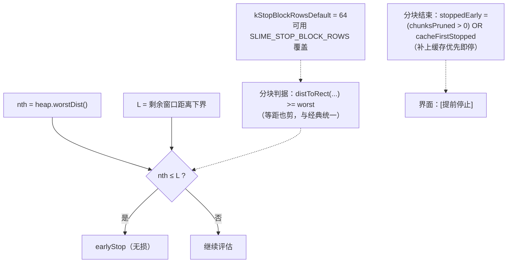

# 及时反馈（达到目标数量即停止）· v3.4.11 版流程与五问答复

> 本文回答用户 v2 流程图末尾列出的五个待确认问题，并把**已按拍板落地的改动**写清楚。
> 代码位置：`src/core/SlimeEngine.cpp`（判据与路径）、`src/gui/MainWindow.cpp`（选项与显示）。

## 一、五个问题的答复（含代码事实）

| # | 问题 | 代码事实 | 结论 / 本轮改动 |
|---|---|---|---|
| 1 | 经典 `nth ≤ L` vs 分块 `L > nth` 是否统一 | 经典：`SlimeEngine.cpp:2139`（滑动分块）与 `:2170`（逐行）都是 `nth <= L`；分块：`:2435` 原为 `distToRect(...) > worst` | **已统一为「等距也剪/也停」**：`:2435` 改为 `>= worst`。依据：堆比较器 `betterThan` 是 `(dist, rank)` 字典序（`:356-360`），等距新窗口只有在 `rank` 更小时才可能替换第 N 名，而堆中第 N 名必然是更早评估者（rank 更小）⇒ 等距剪掉无损。**硬条件已验**：改后 `111/111` 逐位一致、单元 26 组全通过、内核 19 项全通过 |
| 2 | 等距窗口取舍规则？测试覆盖？ | 规则 = `dist` 相同比 `rank`；`rank` 是扫描顺序索引（经典 `:1606`、GPU 路径 `:972`） | 等距取「扫描顺序在前」者；跨扫描顺序（螺旋/光栅/变体）不保证同解。**新增单元组 [26]**：只断言「勾选 vs 不勾选、剪枝 vs 不剪枝结果逐位一致」，不断言具体取哪条（与参考实现同口径） |
| 3 | 经典路径的 `earlyStop` 是否映射到 `out.stoppedEarly`？ | 经典：`:2196 out.stoppedEarly = earlyStop;`（**有映射**）；分块：`out.stoppedEarly = chunksPruned > 0`（**漏了缓存优先即停**） | **真 bug，已修**：分块改为 `(chunksPruned > 0) \|\| cacheFirstStopped`。自检实证：`缓存优先即停：提前停止=1 缓存内即停=1 界面显示[提前停止]=1` |
| 4 | `globalWorstDist` / `heapFullFlag` / `heap` 并发方式 | `heapFullFlag` = `std::atomic<bool>`（`:2287`）；`globalWorstDist` = `std::atomic<double>`（`:2286`，relaxed 读 `:2425`、锁内写 `:2580`）；分块全局堆由 `std::mutex mu` 保护（`:2280`、`unique_lock :2553`、`pushBest` 内更新）；经典路径 `parallelOk` 要求 `!opt.stopAtTarget`（`:2034`） | **无数据竞争**：开及时反馈后经典路径恒为顺序执行（单线程访问 heap）；分块路径堆有锁、两个 atomic 用 relaxed（陈旧值只会「少剪」不会误剪）。本轮不改代码，仅记录结论 + 用测试兜底 |
| 5 | 64 行分块参数来源 | 是我 v3.4.8 定的经验值（局部常量 `kStopBlockRows = 64`） | **已集中为 `kStopBlockRowsDefault` + `stopBlockRows()`**，可用环境变量 `SLIME_STOP_BLOCK_ROWS`（1~4096）覆盖；**新增单测**：`1/7/64/4096` 四种分块大小结果逐位一致 |

## 二、本轮（v3.4.11）对流程的三处修正

## 三、单元测试新增组 [26] 覆盖的四件事

1. **等距一致性**：起点居中、网格奇数、阈值极低 ⇒ 等距窗口密集；勾选/不勾选结果逐位一致。
2. **判界分块不变性**：`SLIME_STOP_BLOCK_ROWS = 1 / 7 / 64 / 4096` 结果逐位一致。
3. **剪枝安全性（2 线程 / 4 线程）**：`SLIME_NO_PRUNE=1` 对照，结果逐位一致；实测剪枝 3~4 块，
   真实扫描 2097 万 → 3369 万区块（剪枝少扫约 38%）。
4. **`cacheFirstStopped ⇒ stoppedEarly`**：缓存优先堆满即停时该标志必须为真。

## 四、GUI 自检新增断言（第 25 组）

- 缓存 + 及时反馈 + **完全被缓存覆盖的子范围** + 单线程 ⇒ `cacheFirstStopped=1`、`stoppedEarly=1`、
  结果区文本含「提前停止」（用户要求「光改代码不测 UI 显示可能漏」）。
- 说明：线程数 ≥ 块数时所有块同时开跑，就没有「尚未开跑」的块可停；多线程下的跨块剪枝由单元组 [26] 覆盖。
