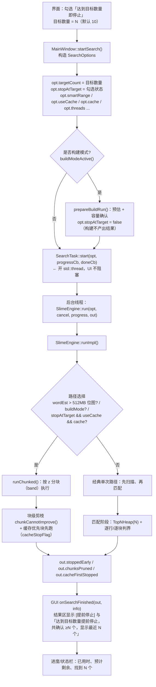

# 及时反馈（达到目标数量即停止）实现流程

> 代码位置：`src/gui/MainWindow.cpp`（界面与选项构造）、`src/core/SearchTask.cpp`（后台线程）、
> `src/core/SlimeEngine.cpp`（扫描/匹配与提前停止判定）、`src/core/SlimeEngine.h`（选项与结果字段）。
> 本文描述 v3.4.9 的实现；「及时反馈」= 选项 `SearchOptions::stopAtTarget`（界面勾选「达到目标数量即停止」+ 目标数量 N）。

## 一、总流程



## 二、判定核心：什么时候可以停

提前停止只用一个判据 —— **「剩余窗口的距离下界 L 已经 ≥ 当前第 N 名的距离 nth」**，
此时剩余任何窗口都不可能进入「最近的 N 个」：

```
nth = heap.worstDist()          // 全局 TopN 堆里第 N 名的距离（堆必须已满 heap.full()）
L   = 剩余窗口的距离下界
if (nth <= L) earlyStop = true  // ⇒ 可以停，且结果仍是「全局最近 N」
```

`L` 的取法（都成立下界，故**无损**）：

| 扫描顺序 | L 的取法 |
|---|---|
| 智能范围（螺旋，锚点行按 \|z − startZ\| 排序） | `L = \|下一行的 z − startZ\|`（同一行内任何窗口的 z 距离都不会更小） |
| 光栅顺序（未勾选智能范围） | `L = distToRect(起点, 剩余锚点行矩形)` |
| 已是最后一行 | `L = +∞` ⇒ 必然停（等价于正常结束） |
| 分块路径（band 粒度） | `chunkCannotImprove(ci)`：本块窗口中心矩形的距离下界 > 第 N 名 ⇒ **整块跳过**（`chunksPruned++`） |

> 为什么无损：判据只依赖「第 N 名距离」。后续只会出现更近的结果 ⇒ 第 N 名距离只会变小 ⇒
> 现在判「进不了前 N」的窗口，之后更进不了。所以跳过它们不会改变最终结果
> （单元测试「提前停止结果 = 完整结果最近 N 个」与参考对照 111/111 都验证了这一点）。

## 三、经典路径的两个匹配形态（v3.4.9 起都真正生效）

```
变体循环（严格模式四向旋转=4 个变体；密度模式=1 个）
  └─ 堆未满 ⇒ 一律先评估（堆满之前没有任何可剪枝依据）
  └─ 堆已满 ⇒ 每评估一小段就判一次界：

     密度 + 滑动窗口（slideOk）：
         for (rb = 0; rb < 行数; rb += 64 行)          // v3.4.9：按 64 行分块推进
             evalDensityBlockTimed(rb, re, heap, …)   // 一次 vertSum 初始化 + 行块滑动
             判界 ⇒ 成立就 earlyStop，跳出

     其它（严格图案 / 保守 / 分层 / 非滑动密度）：
         for each 锚点行 az（顺序：光栅 或 螺旋）
             evalRowSel(az, heap, …)                  // 评估该行全部窗口
             判界 ⇒ 成立就 earlyStop 并 **break**     // v3.4.9：原来只置标志、继续跑完
```

v3.4.9 修掉的三处「不生效」：

1. 行循环判界后**不 break** ⇒ 单变体时提前停止只是个标志位，窗口一个不少（已修）。
2. 密度滑动路径**整段一次跑完** ⇒ 判界永远轮不到（已改为 64 行一块，块间判界）。
3. 判界要求 `dims.size() == 1` ⇒ 严格四向旋转永不触发（已去掉该限制：判据只约束**当前变体**的
   剩余窗口能否进入全局堆，与后续变体无关，仍无损）。

## 四、分块路径（大范围 / 构建 / 缓存+及时反馈）

- 准入条件（`SlimeEngine.cpp` 路径选择）：位图估计 > 512MB、构建模式、或「及时反馈 + 用缓存」。
- 每块（band）开跑前用 `chunkCannotImprove()` 判：堆未满不剪；`heapFullFlag` 由工作线程在堆满时置位；
  `globalWorstDist` 是带陈旧的「第 N 名距离」（偏大只会**少剪**，不会误剪）。
- 「缓存优先」阶段（`stopAtTarget && useCache`）：先跑「锚点行域已被缓存覆盖」的块（填充几乎全靠位图直取），
  堆一满就通过 `cacheStopFlag` 停止后续扫描 ⇒ 这就是「缓存内够数即停」。
- 结束时：`out.chunksPruned`、`out.cacheFirstStopped`、`out.stoppedEarly = chunksPruned > 0`。

## 五、界面反馈

| 位置 | 内容 |
|---|---|
| 进度行 / 状态栏 | 阶段（扫描 / 匹配 / 排序）、百分比、已用时、预计剩余、找到 N 个 |
| 进度流水（底部） | 每 0.5 秒一条「扫描 N/M 区块」「缓存扫描/新区域扫描」等 |
| 结果区首行 | `搜索模式… ｜ … [提前停止]`；结果文本含「达到目标数量提前停止，共确认 ≥N 个，显示最近 N 个」 |
| 反馈面板 | 取消 / 完成 / 警告类消息（成功类不刷屏） |

## 六、自检覆盖（v3.4.9 实测）

`[UI自检] v3.4.8 「达到目标数量即停止」实测`：同一范围跑「勾选 vs 不勾选」两次，比较
`windowsEvaluated / scannedChunks / 耗时 / stoppedEarly / 结果条数`，四模式 × 缓存开关 = 8 组全部变快：

| 模式 | 不勾选（评估窗口） | 勾选（评估窗口） |
|---|---|---|
| 密度 + 智能范围 | 156,816 | **1,188**（约 1/132） |
| 密度 + 光栅 | 156,816 | **79,200** |
| 严格 + 四向旋转 | 640,000 | **82,000** |
| 严格 + 锁定方向 | 160,000 | **82,000** |

同时断言「勾选后结果条数 ≤ 目标数量」；结果内容与不勾选时**逐位一致**（单元 25 组 + 参考 111/111 均通过）。
