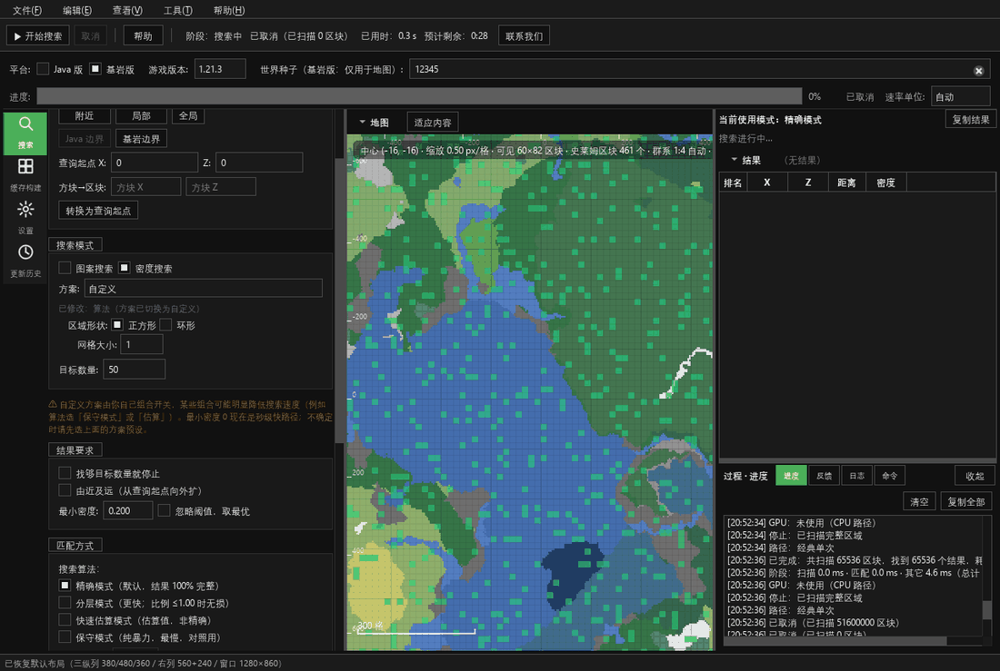

# SlimeFinder 史莱姆区块查找器

Minecraft Java / 基岩版**史莱姆区块查找工具**，原生 **C++20 + Qt 6**，支持 GPU 加速与超大范围搜索；
判定结果与已验证的参考实现逐位一致。

## 这是什么

- 输入种子和范围，快速找出史莱姆区块（密度、图案、环形覆盖）
- 支持 Java 版与基岩版；Java 可搜到世界边界
- GPU（OpenCL）加速，失败自动回退 CPU
- Windows 10/11 x64，便携包解压即用

## 快速导航

| 页面 | 内容 |
|---|---|
| [快速开始](Getting-Started) | 下载、首次搜索、结果使用 |
| [功能说明](Features) | 密度/图案/环形/分层/采样/缓存 |
| [GPU 与性能](GPU-Performance) | 开启 GPU、实测数据、故障排查 |
| [自动更新](Updates) | 版本规则、GitHub/镜像/网盘来源 |
| [常见问题](FAQ) | 杀软误报、GPU 不生效、更新失败等 |

## 下载

- 最新正式版：<https://github.com/PillerBean/SlimeFinder/releases/latest>
- 测试版 / 历史版本：<https://github.com/PillerBean/SlimeFinder/releases>
  （带 `Pre-release` 标记的是测试版；历史版本为二进制归档）

## 核心功能

- **密度模式**：阈值匹配、最优 N 个、提前停止、智能范围、分层/采样
- **图案模式**：2×2、边框、单格、自定义图案与旋转匹配
- **环形模式**：AFK 环形覆盖规划
- **GPU 加速**：密度/图案流式匹配、自动探测、失败回退 CPU
- **大范围搜索**：整图分块、有界内存、历史缓存复用
- **检查更新**：GitHub Releases 官方；官方不可达时自动测速镜像；蓝奏云网盘手动备用

## 相关链接

- 源码与 Releases：<https://github.com/PillerBean/SlimeFinder>
- 更新历史：<https://github.com/PillerBean/SlimeFinder/blob/main/docs/update_history.md>
- 构建说明：<https://github.com/PillerBean/SlimeFinder/blob/main/docs/build_instructions.md>
- 问题反馈：<https://github.com/PillerBean/SlimeFinder/issues>
- 作者 B 站：<https://space.bilibili.com/1413251461>

## 许可

源码公开、**非商业使用**：[PolyForm Noncommercial 1.0.0](https://github.com/PillerBean/SlimeFinder/blob/main/LICENSE)；
再分发/修改版必须保留版权与 Required Notice 并注明来源。商业使用需作者书面授权。
